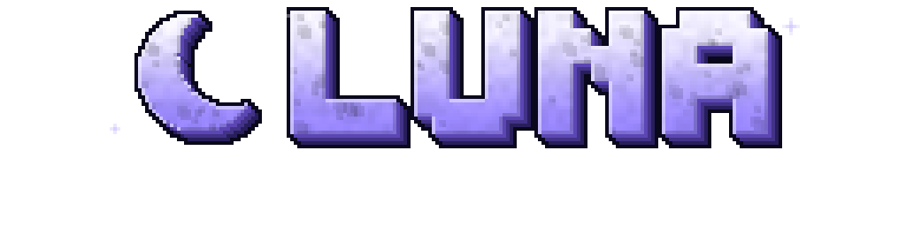

# LUNA

Modpack Fabric pour **Minecraft 26.2** : un maximum d'optimisations et un horizon à perte de vue grâce à **Voxy**.

Tout le jeu porte le thème **LUNA** : logo en roche lunaire, panorama nocturne (lune, Voie lactée, aurore,
lac miroir et montagnes en blocs façon LOD), boutons, curseurs, onglets, cases à cocher et fonds de menus
« verre de nuit », et des splashs en français. Le thème est un petit mod maison (**LUNA UI**, uniquement des
textures, aucun code : zéro impact sur les FPS), donc il est actif d'office sans toucher aux resource packs.



La liste complète des mods, avec leur version et leur rôle, est dans [MODS.md](MODS.md) (générée à chaque build).

## Installer

1. Récupère `dist/LUNA-<version>.mrpack`.
2. Dans l'app Modrinth : **+ (Créer une instance) → Importer depuis un fichier** et choisis le `.mrpack`.
   Prism Launcher, ATLauncher et MultiMC l'importent aussi.
3. Donne au moins **6 Go de RAM** à l'instance (Voxy et C2ME en profitent).

Voxy demande une carte graphique compatible **OpenGL 4.6** (toute carte NVIDIA/AMD récente, Intel Arc).

## Bien utiliser Voxy

Voxy ne « voit » que le terrain déjà chargé : il convertit chaque chunk que tu explores en LOD.
Pour avoir tout l'horizon dès le départ dans un monde solo :

1. Prégénère le monde avec Chunky : `/chunky radius 4000` puis `/chunky start`.
2. Importe-le dans Voxy : `/voxy import world "<nom du monde>"`.

Un monde existant s'importe de la même façon. Garde une **distance de rendu normale basse** (8 à 12 chunks) :
c'est Voxy qui dessine le lointain, bien plus efficacement que le jeu.

Les resource packs qui retexturent l'interface (Default Dark Mode, packs « GUI »…) passent par-dessus le thème
LUNA : désactive-les pour retrouver les menus LUNA.

Côté shaders, Iris est inclus mais seuls les packs qui supportent explicitement Voxy affichent les LOD.

## Identité visuelle

Tout est généré par code, sans image externe :

```bash
node branding/generate.mjs
```

Le script dessine le logo, l'édition, le panorama (6 faces 1024²), les sprites d'interface et l'icône, puis les
écrit dans `luna-ui/assets/` (textures embarquées dans le mod LUNA UI) et `branding/out/` (icône Modrinth 512×512,
aperçus du panorama déplié et des boutons). Les couleurs, les splashs et le décor se règlent en tête de fichier.

## Construire le pack

Il faut juste Node.js 22 ou plus récent.

```bash
node build.mjs
```

Le script résout chaque mod de [pack.config.json](pack.config.json) sur Modrinth pour la version de Minecraft visée
(release en priorité), ajoute les dépendances requises, télécharge les jars pour vérifier leurs hashs,
contrôle les `depends`/`breaks` de chaque `fabric.mod.json` (jars embarqués compris), construit le mod LUNA UI depuis `luna-ui/`, puis écrit
`dist/LUNA-<version>.mrpack` et `MODS.md`. Ajouter un mod = ajouter une ligne dans `pack.config.json`.

Le dossier `overrides/` (s'il existe) est copié tel quel dans l'instance (configs, resource packs…).

### Tester pour de vrai

```bash
node tools/test-launch.mjs
```

Installe le pack dans une instance jetable (`.test/`), génère un monde avec le serveur vanilla, lance le jeu
en solo (compte hors ligne) et vérifie qu'il charge le monde sans crash. `--keep` laisse le jeu ouvert.
Si le jeu reste sur un menu (écran de premier lancement), ouvre le monde `LunaTest` à la main.

## Publier sur Modrinth

Crée un projet de type **Modpack** sur modrinth.com, puis **Versions → Create a version** et dépose le `.mrpack`
(loader Fabric, version 26.2) et mets `branding/out/icon.png` en icône du projet. Pense à créditer et lier Voxy sur la page du projet, comme son auteur le demande.
