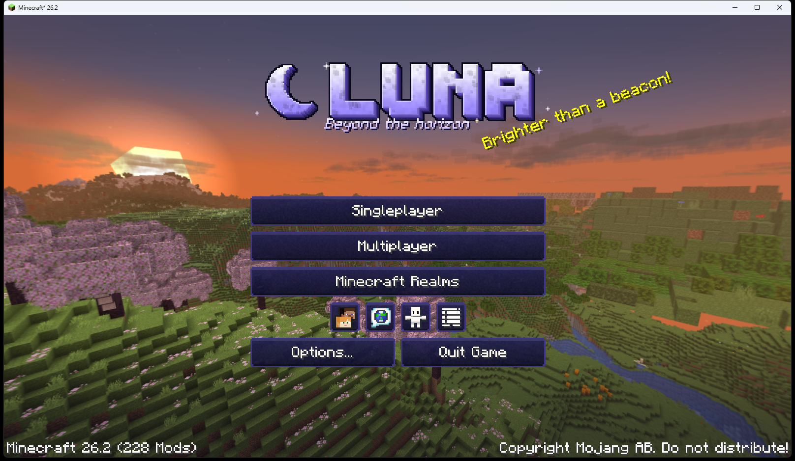

# LUNA

Modpack Fabric pour **Minecraft 26.2** : un maximum d'optimisations, un horizon à perte de vue grâce à **Voxy**,
de l'ambiance (sons, particules, nuages, lumières dynamiques), une sélection de packs de ressources et un thème
**LUNA** sur tous les menus.



Le contenu exact (mods, packs, shaders, versions) est dans [MODS.md](MODS.md), régénéré à chaque build.

## Ce qu'il y a dedans

- **Optimisations** : Sodium, Lithium, C2ME, ScalableLux, FerriteCore, ModernFix, Nvidium, ImmediatelyFast,
  Entity Culling, MoreCulling, Better Block Entities, VMP, Ixeris, Gnetum, Particle Core… et Voxy pour le lointain.
- **Cartes et infos** : minimap et carte du monde Xaero (+ XaeroPlus), Jade, AppleSkin, compteur de jours
  au-dessus de la barre d'objets (les coordonnées sont sous la minimap).
- **Inventaire** : ClientSort (tri au clic molette) et Mouse Tweaks.
- **Ambiance** : Sound Physics Remastered, AmbientSounds, Presence Footsteps, Falling Leaves, Particle Rain,
  Wakes, Better Clouds, Subtle Effects, LambDynamicLights, 3D Skin Layers.
- **Packs de ressources** : Fresh Animations (+ extensions), Fresh Food, Better Leaves, Default Dark Mode,
  Fullbright UB… activés au premier lancement. Les moteurs qu'ils exigent sont inclus : EMF + ETF
  (Fresh Animations), Continuity (contours de NewGlowingOres), Respackopts.
- **Shaders** (désactivés par défaut) : Complementary Reimagined et Unbound, BSL, Bliss, MakeUp Ultra Fast.
- **Graves** : une tombe garde tes objets quand tu meurs (le mod active `keep_inventory` pour fonctionner).
- **Sona pour Minecraft** : le lecteur Sona en jeu (mod maison, sources dans `D:\Code\sona-minecraft`).
- **Thème LUNA** : logo, sous-titre « Beyond the horizon », splashs en anglais, panorama 3D réel capturé en jeu,
  boutons, curseurs, onglets et fonds de menus.

## Installer

1. Récupère `dist/LUNA-<version>.mrpack`.
2. Dans l'app Modrinth : **+ (Créer une instance) → Importer depuis un fichier** et choisis le `.mrpack`.
   Prism Launcher l'importe aussi.
3. Donne au moins **6 Go de RAM** à l'instance.

Au **premier lancement** d'une instance neuve, Default Options applique les réglages LUNA (packs de ressources
activés dans le bon ordre, distance de rendu 12, écran de chargement sombre). Ensuite tes réglages ne sont plus
jamais écrasés. Sur une instance qui existait déjà, active les packs à la main dans Options › Resource Packs.

Le thème LUNA existe en mod (toujours actif) et en pack « LUNA UI » placé en haut de la liste : il passe ainsi
devant les packs d'interface comme Default Dark Mode, qui restent appliqués partout ailleurs (inventaires…).

## Bien utiliser Voxy

Voxy ne « voit » que le terrain déjà chargé. Pour avoir tout l'horizon dès le départ dans un monde solo :

1. Prégénère le monde avec Chunky : `/chunky radius 1500` puis `/chunky start`.
2. Importe-le dans Voxy : `/voxy import world "<nom du monde>"`.

Garde une distance de rendu normale basse (8 à 12 chunks) : c'est Voxy qui dessine le lointain. Côté shaders,
seuls ceux qui supportent explicitement Voxy affichent les LOD.

## Identité visuelle

```bash
node branding/generate.mjs
```

Dessine le logo, le sous-titre, les sprites d'interface, les fonds, l'icône Modrinth et écrit les splashs, dans
`luna-ui/assets/` et `branding/out/`. Le panorama vient de `branding/panorama/` (capture réelle) ; si ce dossier
est vide, un panorama procédural est dessiné à la place.

### Recapturer le panorama 3D

Minecraft 26.2 sait capturer un vrai panorama (6 faces) quand on le lance avec les propriétés de debug
`MC_DEBUG_ENABLED` et `MC_DEBUG_PANORAMA_SCREENSHOT` :

```bash
node tools/test-launch.mjs --panorama
```

En jeu : place-toi (le regard donne la face d'ouverture de l'écran titre), cache l'interface avec F1, puis
**Ctrl+F2**. Les faces arrivent dans `.test/instance/screenshots/` : copie-les dans `branding/panorama/` et relance
le générateur. Xaero est retiré pendant cette séance (sa minimap plante pendant la capture).
[tools/game-input.ps1](tools/game-input.ps1) permet d'envoyer des commandes au jeu depuis PowerShell
(utiliser des coordonnées absolues : `~` est une touche morte en AZERTY).

## Construire le pack

```bash
node build.mjs
```

Le script résout chaque mod, pack et shader de [pack.config.json](pack.config.json) sur Modrinth (version épinglée
ou la plus récente pour la version de Minecraft visée), ajoute les dépendances, vérifie les hashs, contrôle les
`depends`/`breaks` de chaque `fabric.mod.json` (jars embarqués et mods maison compris), construit le mod et le pack
LUNA UI, écrit les réglages Default Options, puis produit `dist/LUNA-<version>.mrpack` et `MODS.md`.

### Tester pour de vrai

```bash
node tools/test-launch.mjs
```

Installe le pack dans une instance jetable (`.test/`), génère un monde avec le serveur vanilla (triches activées),
lance le jeu en solo (compte hors ligne), vérifie qu'il charge le monde sans crash et capture l'écran.
`--menu` s'arrête sur l'écran titre et le capture dans `.test/screens/`.

## Publier sur Modrinth

Crée un projet de type **Modpack**, puis **Versions → Create a version** et dépose le `.mrpack` (loader Fabric,
version 26.2), avec `branding/out/icon.png` en icône. Pense à créditer et lier Voxy sur la page du projet, comme
son auteur le demande. Sona et LUNA UI sont des mods maison livrés dans le pack (overrides).
